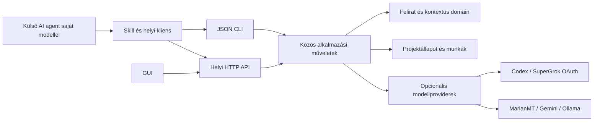

# Subtitle Assistant — eszközközpontú fejlesztési terv

Dátum: 2026-11-16; implementációs állapot frissítve: 2026-11-18. M0/M1 mag és M2 agentes szolgáltatások elkészültek, az M7a korai GUI működő előzetese elérhető. A roundtrip eredmény az [M0/M1 pilotjelentésben](m0-m1-pilot.md), az első fordítási elfogadási állapot az [M2 pilotjelentésben](m2-agent-pilot.md), a futtatható parancsok az [agentes munkafolyamatban](agent-tool-workflow.md) találhatók. A [GUI-preview](gui-preview.md) és a teljes FBI első munkaváltozat használati elfogadása folyamatban; az M7a kilépési feltételei és a későbbi mérföldkövek még nyitottak.

## 1. Cél és rögzített prioritások

A Subtitle Assistant közös feliratkezelő magra épülő eszközzé fejlődik. Külső AI agent saját modelljével dolgozhat rajta, az önálló alkalmazás pedig ugyanazokat a műveleteket használja GUI-ból és előfizetéses OAuth-modellekkel. Az első használható eredmény az agentes fordítási munkafolyamat legyen.

Joe által rögzített igények:

1. Elsődleges a fordítás minősége és következetessége: történet, jelenet, karakterek, nevek, terminológia és megszólítás.
2. Az eszközként használható változat élvez prioritást. Cody fejlesztés közben maga is használja és teszteli, valódi feliratokon.
3. Az agentes elérés alapja egyszerű helyi API, gépi kimenetű CLI és skill legyen. Ne legyen hozzá külön fiók- vagy MCP-regisztrációs folyamat.
4. A Codex/ChatGPT és SuperGrok előfizetéses OAuth-támogatás követelmény az önálló AI-használathoz; API-kulcsos megoldás nem teljesíti ezt.
5. A GUI korai, OAuth-tól független felügyelő- és szerkesztőfelület legyen: egymás melletti forrás/célnyelv, kézi szöveg- és időzítésjavítás, élő agentállapot. Joe már a fejlesztés közben követni és javítani tudja az agentes munkát.
6. Az OAuth-megvalósíthatósági próbák és az önálló OAuth-fordítás a felügyelhető agentes munkafolyamat utánra kerülnek; nem futnak előrehozott kutatási ágként.
7. Képkockák bevonhatók a kontextus javításához, és a videóból történő SRT-előállítás is fontos későbbi lehetőség. A működő agentes eszköz és GUI után külön döntés születik arról, hogy az OAuth, a képkockás kontextus vagy az STT következzen előbb.

A sorrend és az elfogadási feltételek az alábbi terv ajánlásai. Konkrét GUI-keretrendszer, metadata-szolgáltató vagy OAuth-híd még nincs véglegesen kiválasztva. A terv nem indít telepítést, bejelentkezést vagy szolgáltatást.

## 2. Ellenőrzött kiinduló állapot

Forrásalap: a helyi `develop` munkapéldány, HEAD `01eb7a43`, 2026-11-15/16-i áttekintés. A távoli branch aktuális állapotáról ez nem állítás.

| Terület | Meglévő alap | A tervhez szükséges változás |
|---|---|---|
| SRT | `subtitle_translator/srt_parser.py`: parser, időbélyegek, sortördelés, HTML-kezelés | Veszteségjelzés, stabil bejegyzésazonosítók, eredeti másolat és külön szerkeszthető munkaváltozat |
| Fordítás | `translator.py`, MarianMT/Ollama/Gemini provider | A feliratműveletek leválasztása a motorok inicializálásáról; egységes csomagszerződés |
| Belépés | `main.py`, `translate_all_srt.ps1`, `reformat_srt.py` | Külön gépi belépési pont; az emberi CLI kompatibilitásának megőrzése |
| Függőségek | A package importja automatikusan providereket is tölt | A mag/CLI/API működjön Torch, Transformers, Ollama és felhős belépés nélkül |
| Folyamatmentés | `progress.py`, `.progress` fájlok | Tartós projekt- és csomagállapot, tranzakciók, revízió és ismételt beküldés kezelése |
| Kontextus | `multi_model.py`, `StoryContext` | A jelenlegi első 15 bejegyzéses elemzés és helykitöltő parser helyett valódi, tartós kontextus |
| Gemini | Csomagolt fordítás és összerendelési regressziók | A sikeres részeredmények csomagonként mentődjenek; hiányzó fordítás legyen látható állapot |
| Tesztek | Valódi assert/mock tesztek és régi nyomtató demók vegyesen | A kritikus működést a tényleges alkalmazáskódon ellenőrző, kicsi regressziós csomag |

A `multi_model.py::_parse_context_analysis` jelenleg helykitöltő karakteradatokat ad és a válasz első 200 karakterét tárolja összefoglalóként. A Gemini API-batch útvonala megelőzi a multi-model útvonal kiválasztását. A dokumentált többmodellű architektúra ezért nem bizonyítja a kívánt történet-/karakterkezelés meglétét.

Az áttekintésben futott célzott ellenőrzés: `tests/unit/test_api_batch_cross_entry.py`, **6 sikeres teszt**, mock providerrel. Ez nem teljes tesztcsomag és nem éles fordításminőségi mérés.

Megőrzendő helyi módosítások: `subtitle_translator/core/rate_limiter.py` és `translate_all_srt.ps1`. A későbbi fejlesztés ezeket előbb külön diffként felméri; nem írja felül és nem sorolja automatikusan a saját változásai közé.

## 3. Közös architektúra és használati módok



### 3.1. Közös mag

- Felirat importja és diagnosztikája; eredeti másolat megőrzése és szerkeszthető forrás-/fordítási munkaváltozat.
- Stabil bejegyzésazonosítók, időbélyegek és formázási szabályok.
- Fordítási csomagok, jelenetkörnyezet, kontextus és glosszárium kezelése.
- Fordítások visszaillesztése, ellenőrzése, revíziója és exportja.
- Tartós állapot és folytathatóság, a modellhozzáférés módjától függetlenül.

A mag nem indít modellt vagy bejelentkezést egy felirat megnyitásához. A régi `TranslationProgress` konstruktorában végzett signal-handler regisztrációt sem szabad közvetlenül HTTP workerből használni; a futtatókörnyezet kezelése az adapter feladata.

### 3.2. Külső agentes mód — elsődleges

Az agent olvassa a forrást és a kontextust, saját modelljével fordít, majd strukturált eredményt küld vissza. Az alkalmazás ezen az útvonalon nem indít második modellt vagy rejtett fordítóagentet. Az előfizetés az agent saját környezetében marad; a feliratprojekt nem függ az alkalmazás OAuth-hozzáférésétől.

### 3.3. Önálló alkalmazásmód

A korai GUI a külső agentes munkát követi és szerkeszti, alkalmazásoldali AI-belépés nélkül. Később a felhasználó önálló modellmunkát is indíthat GUI-ból vagy CLI-ből. Az alkalmazás választott providere ugyanazt a csomagot kapja és ugyanazt a beküldési/ellenőrzési szerződést teljesíti, mint egy külső agent. A GUI és az agent párhuzamosan is dolgozhat ugyanazon projekten, verzióellenőrzött módosításokkal.

### 3.4. API, CLI és skill — regisztráció nélkül

- **CLI:** közvetlen, folyamaton belüli szolgáltatáshívásra is képes; használatához nem kell futó HTTP szerver.
- **HTTP API:** verziózott, alapból loopback címen induló helyi szolgáltatás. Ezt használja a GUI és az az agent, amelynek ez kényelmesebb.
- **Skill:** rövid belépési útmutató a tényleges parancsokhoz és a munkafolyamathoz. A részletes sémákat csak szükség esetén tölti be.
- **MCP:** nincs az első mérföldkövek függőségei között. Későbbi vékony adapterként értékelhető, ha bizonyítható előnyt ad külön üzleti logika nélkül.
- A felirateszköz futási feltételei között nincs Obsidian vagy Mission Control: a projektállapot helyben tartós. Az agent saját memória-/indítási szabályai ettől külön maradnak.

A helyi API-hoz nincs felhasználói fiók vagy kézi kliensregisztráció. Ha a helyi HTTP-hozzáférés titkot igényel, azt az indító generálja és a helyi kliens kezeli; nem kerül az agent válaszaiba. A későbbi szolgáltatói OAuth-belépés ettől külön, szükséges felhasználói művelet.

## 4. Projektadatok és működési szerződés

### 4.1. Tárolás és azonosítás

M0-ban rögzített kezdeti tárolás: a munkakönyvtár `.local/subtitle-assistant/` mappájában `workspace.sqlite3`, tranzakciókkal. Az eredeti forrás byte-jai BLOB-ként a projekt rekordjában archiválódnak, a munkaszöveg/időzítés külön mezők. Így az import egyetlen tranzakcióban menthető. Az exportok külön fájlok; a felhasználói munkatér és pilotadat nem verziózott.

| Objektum | Lényeges adatok |
|---|---|
| Workspace | Séma- és API-verzió, projektek, beállítások, migrációs verzió |
| Project | `project_id`, forráshash, nyelvek, revízió, film-/epizódazonosítás |
| Entry | Belső `entry_id`, eredeti sorszám/pozíció és eredeti adatok; külön aktuális forrásszöveg, időzítés és revíziók |
| Translation | Célszöveg, állapot, eredet/provider, revízió, használt kontextusverzió |
| Context | Sorozat/film/epizód/jelenet szint, állítások, forrás és érvényességi tartomány |
| Batch | Bejegyzésazonosítók, csak olvasható környezet, forrás- és kontextusverzió |
| Job | Állapot, csomagok, mentési pont, hiba, folytatási információ |
| AgentActivity | Munkához rendelt agent, fázis, aktuális csomag/bejegyzések, utolsó visszajelzés és frissesség |
| Edit | Kézi vagy agentes módosítás eredete, előző/új érték, érintett revíziók és visszaállítási hivatkozás |
| Receipt | `request_id`, payload hash, eredmény és a létrejött revízió |
| Issue | Kód, súlyosság, érintett bejegyzés, bizonyíték, rendezési állapot |

Az SRT sorszáma nem belső elsődleges kulcs: duplikált sorszámot diagnosztizálni kell, és meg kell őrizni a forráspozíciót. A bejegyzésazonosító import után stabil. A forrásfájl megváltozását hash érzékeli; a meglévő projektre nem szabad észrevétlenül másik forrást ráhúzni.

Az eredeti importált fájl és annak adatai változatlanul megmaradnak. A projekt munkaváltozatában a forrásszöveg, a célszöveg és az időzítés külön, naplózott szerkesztési művelettel javítható. Ez a későbbi STT felismert szövegére is érvényes. A normál fordítási beküldés kizárólag célszöveget és fordítási állapotot ad vissza; a kézi forrás-/időzítésjavítás önálló művelet.

A forrásszöveg vagy az időzítés javítása új revíziót hoz létre, és újraértékelteti az érintett fordításokat, csoportosítást és olvashatósági problémákat. A korábbi célszöveg megmarad az előzményben és szükség esetén `needs_review` állapotot kap. Az export az aktuális, elfogadott munkaváltozatból készül; a sorvég/encoding/sortördelés dokumentált profilból származik. Az eredeti másolat ettől külön elérhető.

### 4.2. Állapotok és ellenőrzések

- Munka: `pending`, `running`, `pause_requested`, `paused`, `needs_attention`, `completed`, `failed`, `cancelled`.
- Fordítás: `untranslated`, `draft`, `translated`, `intentionally_preserved`, `needs_review`.
- Felülvizsgálat: külön `unchecked`, `agent_reviewed`, `human_reviewed` jelölés és eredet. A strukturális siker nem emberi nyelvi elfogadás.
- A kihagyott kreditsor, a szándékosan megőrzött tulajdonnév és a hiányzó fordítás külön eset.
- Hiányzó vagy gyanús eredmény nem válik kész fordítássá attól, hogy a rendszer visszamásolja az eredeti szöveget.

A strukturális ellenőrzés bejegyzésszámot, azonosítókat, időbélyegeket, tag-eket, üres kimenetet és állapotokat vizsgál. A konfigurálható olvashatósági profil sorhosszt, sorszámot és karakter/másodperc értéket jelez. A szemantikai/névkonzisztencia-ellenőrzés külön réteg; nem kap kitalált pontossági százalékot.

### 4.3. Beküldés, ismétlés és párhuzamos használat

- Minden módosítás kap `request_id`-t és elvárt revíziót; a kliens ezeket automatikusan előkészíti.
- Egy beküldés egy tranzakció: sérült vagy részleges payload nem ír fél csomagot.
- Ugyanaz az ID és ugyanaz a tartalom ugyanazt a nyugtát adja; ugyanaz az ID eltérő tartalommal hibát ad.
- Timeout után a kliens lekérdezi a nyugtát. Nem indít új, azonos értelmű módosítást új ID-val találomra.
- Elavult revízió ütközést ad; GUI és agent nem írja felül egymás frissebb fordítását.
- A kézzel javított célszöveg alapból védett az automatikus felülírástól; új agentjavaslat külön változatként vagy összevethető különbségként jelenik meg. A kézi módosítás nem jelenti automatikusan a teljes részlet emberi elfogadását.
- A forrás-/időzítésjavítás után régi adatra épülő folyamatban lévő csomag nem írható vissza észrevétlenül: verzióütközés és friss csomag szükséges. Más, nem érintett részek feldolgozása folytatható.
- Az átfedő környezet olvasható referencia, nem újra beküldendő fordítási tartomány.
- Kontextusmódosításnál láthatóvá válik, mely kész fordítások támaszkodtak régebbi adatra; ez nem indít automatikusan teljes újrafordítást.

### 4.4. Export

A normál kész export nem tartalmazhat észrevétlenül lefordítatlan bejegyzést. A részleges export külön, kifejezetten kért mód, `.partial.srt` jelöléssel és hiánylistával. A felhasználó által kért részleges forrásmegőrzés is látszik a jelentésben. Meglévő fájl felülírása csak explicit célválasztással történik; a normál út új kimenetet készít atomikusan.

Az aktuális, kézzel is javított forrás-SRT és a célnyelvi SRT külön exportálható. A célnyelvi export a munkaváltozat aktuális időzítését használja; a forrásszöveg javítása a fordítás bemenetét és a forrásoldali exportot módosítja, nem kever forrásnyelvű szöveget a kész célnyelvi feliratba.

### 4.5. Élő agentállapot és emberi felügyelet

A GUI az alkalmazáson kívüli agent állapotát kifejezett munkajelzésekből követi. Az agent/kliens jelzi a munka kezdetét, fázisváltást, aktuális csomagot, várakozást, hibát és befejezést; hosszabb feldolgozásnál életjelet is adhat. A felület mutassa az agent nevét/címkéjét, az aktuális feladatot, az utolsó jelzés idejét és a ténylegesen elkészült mennyiséget.

A friss jelzés nélküli agent állapota `stale`/ismeretlen, nem marad korlátlanul „dolgozik”, és nem válik automatikusan kész munkává. A kliens elérhetősége és a fordítási munka aktivitása külön adat. Az aktivitásfrissítés nem növeli a felirat tartalmi revízióját; a GUI inkrementális állapot-/eseményfrissítést kap, nem olvassa újra minden jelzésnél a teljes projektet.

Joe kérheti a munka szüneteltetését vagy visszavonhatja a további beküldést. Külső agentnél a szünet együttműködő: az agent a következő művelethatáron visszaigazolja; addig a GUI „szünet kérve” állapotot mutat. Az alkalmazás nem ígéri egy külső harness számításának azonnali leállítását. A skill minden új csomag és beküldés előtt ellenőrzi a vezérlési állapotot.

## 5. Tervezett agentes szerződés

Az alábbi táblázat a teljes tervezett művelettér és eredeti REST-javaslat. **M2 az összes implementált domainművelethez közös `POST /api/v1/operations` végpontot használ**, `operation` és `arguments` mezőkkel; a táblázat erőforrásonkénti REST-útvonalai nem futtatható végpontok. A tényleges CLI/HTTP alakok az [agentes munkafolyamatban](agent-tool-workflow.md), a [JSON-sémában](schemas/tool-v1.schema.json) és az [OpenAPI-ban](schemas/tool-v1.openapi.json) szerepelnek. Kontextus/provider/GUI funkciók a későbbi mérföldkövekhez tartoznak.

### 5.1. Művelettérkép

| Feladat | CLI-művelet | HTTP API-javaslat |
|---|---|---|
| Képesség és verzió | `capabilities --json` | `GET /api/v1/capabilities` |
| Diagnosztika | `doctor --json` | `GET /api/v1/health` |
| Projekt importja | `project import --input ... --json` | `POST /api/v1/projects/import` |
| Projekthelyzet | `project status --project ... --json` | `GET /api/v1/projects/{id}` |
| Bejegyzések lapozása | `entry list --project ... --cursor ... --json` | `GET /api/v1/projects/{id}/entries` |
| Kézi szöveg-/időzítésjavítás | `entry edit --request ... --json` | `POST /api/v1/projects/{id}/entry-changes` |
| Előzmény és visszaállítás | `entry history`, `entry restore --request ... --json` | `GET /api/v1/entries/{id}/history`, `POST /api/v1/entries/{id}/restore` |
| Kontextus lekérése | `context get --project ... --json` | `GET /api/v1/projects/{id}/context` |
| Kontextus módosítása | `context apply --request ... --json` | `POST /api/v1/projects/{id}/context/changes` |
| Csomag előkészítése | `batch prepare --request ... --json` | `POST /api/v1/projects/{id}/batches` |
| Fordítás beküldése | `batch submit --request ... --json` | `POST /api/v1/batches/{id}/translations` |
| Ellenőrzés | `project validate --project ... --json` | `POST /api/v1/projects/{id}/validations` |
| Problémalista | `issue list --project ... --json` | `GET /api/v1/projects/{id}/issues` |
| Munka/folytatás | `job status`, `job resume` | `GET /api/v1/jobs/{id}`, `POST /api/v1/jobs/{id}/resume` |
| Agent munkajelzése | `job activity --request ... --json` | `POST /api/v1/jobs/{id}/activity` |
| Felügyelet és változások | `job pause`, `job cancel`, `project events` | `POST /api/v1/jobs/{id}/pause`, `POST /api/v1/jobs/{id}/cancel`, `GET /api/v1/projects/{id}/events?after={cursor}` |
| Export | `project export --request ... --json` | `POST /api/v1/projects/{id}/exports` |
| Bizonytalan kérés | `request receipt --request-id ... --json` | `GET /api/v1/requests/{request_id}` |

A változtató CLI-k közös request-sémát használjanak, a nagy JSON-t `--request <fájl>` vagy stdin útján kapják. Ne legyenek hosszú, shellbe másolt feliratszövegek. `--json` esetén stdouton egy gépi eredmény legyen, a diagnosztika stderren; az exit code az eredményt tükrözze.

```powershell
# M2-ben mindhárom példa működik; a submit pontos kérésalakját lásd a workflow-ban.
.\.venv\Scripts\python.exe -m subtitle_translator.tool capabilities --json
.\.venv\Scripts\python.exe -m subtitle_translator.tool project import --input "D:\media\episode.en.srt" --json
.\.venv\Scripts\python.exe -m subtitle_translator.tool batch submit --request ".local\requests\translation.json" --json
```

A HTTP-válaszok a megfelelő HTTP státuszkód mellett közös envelope-ot adnak: `ok`, `api_version`, `request_id`, `data`, `warnings`; hiba esetén stabil `error.code`, érthető üzenet és konkrét javítási információ. Példakódok: `revision_conflict`, `source_changed`, `batch_incomplete`, `provider_not_entitled`, `reauth_required`, `rate_limited`.

### 5.2. Csomag és fordítás szétválasztása

A csomag tartalmazza a fordítandó bejegyzéseket, az előtte/utána lévő csak olvasható környezetet, a releváns globális és jelenetkontextust, valamint a kötött névhasználatot. Mérete költség-/karakterkerethez igazítható. Az agentnek nem kell minden körben a teljes filmet újra beolvasnia.

Egy beküldés illusztratív alakja:

```json
{
  "request_id": "b1c3b993-382b-4e36-a4e9-ad6d72e728a3",
  "expected_project_revision": 12,
  "batch_id": "batch_0012",
  "source_sha256": "aaaaaaaaaaaaaaaaaaaaaaaaaaaaaaaaaaaaaaaaaaaaaaaaaaaaaaaaaaaaaaaa",
  "context_revision": 4,
  "translations": [
    {"unit_id":"unit_0042","entries":[{
      "entry_id":"entry_0042","text":"Holnap találkozunk.",
      "state":"translated","review_state":"agent_reviewed"
    }]}
  ]
}
```

A fenti azonosítók példaértékek; a valódi értékeket az előkészített csomag adja, a projekt-/csomagrevízió pedig a kézi javításokat is lefedi. A fordítási beküldés nem kér az agenttől új időbélyegeket vagy új SRT-sorszámokat; időzítést külön, kifejezett szerkesztési művelet változtat.

### 5.3. Skill és felfedezhetőség

Javasolt forráshely: `skills/subtitle-assistant/SKILL.md`. Ebben rövid `name`/`description`, feladatfelismerés, belépési parancs, munkafolyamat és néhány lényeges invariáns szerepeljen. A sémák és részletes eljárások külön, csak szükség esetén olvasott hivatkozások legyenek.

- A projekt ténylegesen betöltődő indítóutasítása röviden hivatkozzon a skillre és az egyetlen diagnosztikai parancsra; ne csak egy hosszú README mélyén legyen elérhető.
- A skill ne egy konkrét modellhez vagy MCP-regisztrációhoz kötődjön.
- A `capabilities` közölje, mi működik, hol a munkatér, és mi a következő érvényes művelet; ne igényeljen külön registryt.
- A skill jelezze az aktív munkát és annak fázisát, ellenőrizze a GUI-ból kért szünet/leállítás állapotát, és tartsa tiszteletben a kézi javításokat. A GUI a ténylegesen visszaigazolt állapotot mutassa.
- Leállt API esetén a kliens meg tudja különböztetni a szolgáltatáshiányt a hibás projektadatoktól, és használhassa a közvetlen CLI-utat. A CLI hibáját ne kerülje meg kézi adatbázis- vagy SRT-átírással.
- Külön munkatérből induló agent nem ismerheti automatikusan ezt a repositoryt: ott egy elérhető kliensútvonal vagy betöltött skillhivatkozás szükséges. A terv nem ígér minden harnessre globális automatikus felfedezést.
- Képességhiba esetén konkrét diagnózis kell: hiányzó Python, rossz útvonal, nem támogatott szerződésverzió vagy leállt API. Az agent ne állítsa általánosan, hogy „nem tudja használni”, ha csak másik belépési út szükséges.

## 6. Kontextusos fordítás

### 6.1. Kontextusszintek

1. **Azonosítás:** fájlnév, kiadási cím, év, évad/epizód és opcionális külső forrás alapján film-/epizódjelöltek; az eredmény javítható.
2. **Sorozat/film:** szereplők és névváltozatok, elfogadott magyar nevek, visszatérő terminológia, világismeret.
3. **Epizód:** az adott rész forrásszövegéből készített teljesebb összefoglalás, szereplők és helyzetek.
4. **Jelenet:** közvetlen előzmény és folytatás, témaváltás, beszélő/címzett feltételezése és bizonyítéka.
5. **Bejegyzés:** konkrét forrásszöveg, fordítás, döntések és felülvizsgálati igény.

Nagy anyagnál szakaszos elemzésből álljon össze az epizódkontextus; az első 15 sor ne helyettesítse az egész történetet. A fordítócsomag csak a feladathoz szükséges összefoglalókat és bizonyítékokat kapja.

### 6.2. Bizonyíték és következetesség

- Az ellenőrzött metadata, a feliratból/képből származó megfigyelés és az AI-következtetés külön eredetjelölést kapjon.
- Egy szereplő jelenléte a szereplőlistában vagy egy képkockán nem bizonyítja, hogy ő mondta az adott sort.
- Beszélő és címzett maradhat `unknown`; bizonytalanság esetén kérdés/probléma rögzülhet kitalált azonosság helyett.
- A viszony és megszólítás jelenet-/időszakasz-függő lehet. Egy későbbi kibékülés vagy tegeződés nem írhatja át automatikusan az előző jeleneteket.
- Az agent által talált információ forrás-URL-lel vagy bejegyzés-/képkockaazonosítóval menthető; a modell emlékezete önmagában jelölt adat.
- A glosszárium engedje a névváltozatokat és magyar ragozott alakokat; nyers karakterlánc-egyezés nem elég a konzisztencia megítéléséhez.
- A meglévő hangjelölések, beszélőcímkék és zenei jelzések megőrzése/fordítása korai követelmény. Új hangjelölések felismerése külön későbbi funkció.

Külső metadata-szolgáltató nem előfeltétele az első pilotnak: az agent saját keresési lehetőségével gyűjthet forrást, és kézi adat is megadható. Beépített metadata-adapter csak igazolt használati előny esetén kerül be; külön szolgáltatói regisztráció nem épülhet észrevétlenül az alapútba.

### 6.3. Félmondatok és időzített visszaillesztés

A fordítás egysége az összefüggő mondat-/párbeszédrész; az export egysége az időzített feliratbejegyzés. A megjelenítési sor, a bejegyzés és a fordítási egység három külön fogalom. A több bejegyzésre széteső szöveget csoportként kell értelmezni és fordítani, a csoportot az API-csomag mérethatára sem vághatja el észrevétlenül. A fordítandó és csak kontextust adó bejegyzések határa egyértelmű marad.

A célnyelvi tördelés és a szöveg bejegyzések közötti eloszlása eltérhet a forrástól, de a visszaillesztés az eredeti stabil bejegyzésazonosítók és az aktuális start/stop időablakok szerint történik. Sortördelés nem hozhat létre index- vagy időzítéseltolódást. A formázás hatóköre — sor-/bejegyzéshatáron átnyúlva is — és a beszélőváltás jelentése megőrzendő.

A magyar szórend miatt a karakterarányos szövegszétosztás önmagában nem igazolja a jó időzítést. A pilotban külön ellenőrizni kell, hogy a lényeges közlés a megfelelő képi/párbeszédbeli pillanatnál jelenik-e meg, és nem kerül-e egyik beszélő szövege a másikéhoz. Hiány, ismétlés, eltolódás vagy bizonytalan visszaillesztés javítandó esetet ad, csendes padding/truncation helyett. A normál fordítás nem tolja el automatikusan a munkaváltozat időbélyegeit. Joe a szerkesztőben külön, visszakereshető időzítésjavítást végezhet.

## 7. Mérföldkövek és függőségek

Minden mérföldkő használható eredményt és külön ellenőrizhető kilépési feltételt ad. Az alábbiak javasolt munkacsomagok, nem naptári ígéretek. Az OAuth-fiókpróba és az emberi nyelvi elfogadás külső részvételt is igényelhet.

| Mérföldkő | Prioritás | Előfeltétel | Bemutatható eredmény |
|---|---|---|---|
| M0 — szerződés és minták | P0 | — | Rögzített mag/adat/API-szerződés és pilotanyag |
| M1 — feliratmag és projekt | P0 | M0 | Modelltől független import, vizsgálat és roundtrip CLI-ből |
| M2 — agentes eszköz MVP | P0 | M1 | API + JSON CLI + skill; Cody végigfordít egy rövid részletet |
| M7a — korai felügyelő és szerkesztő GUI | P0 | M2 | Kétoszlopos szerkesztés, időzítésjavítás és élő agentállapot OAuth nélkül |
| M3 — történet- és karakterkontextus | P0 | M2 | Tartós kontextussal és glosszáriummal fordított jelenetek |
| M7b — kontextus- és felülvizsgálati GUI | P0 | M7a, M3 | Kontextus/glosszárium javítása, érintett fordítások követése |
| M4 — teljes epizód és folytatás | P0 | M3, M7a, M7b | Joe által végigkövethető és javítható agentes epizódfordítás |
| Következő bővítés kiválasztása | Döntési pont | M4 és a közös GUI pilotja | OAuth, képkockák és STT aktuális hasznának összevetése |
| M5 — OAuth megvalósíthatósági próbák | Későbbi, sorrend nyitott | Döntési pont után, ha az OAuth következik | Külön valós Codex- és SuperGrok-modellhívás eredménye |
| M6 — önálló OAuth-fordítás | Későbbi, sorrend nyitott | M5 adott providerének sikere | Beépített providerek ugyanazzal a csomagszerződéssel, GUI-s kapcsolati nézettel |
| M8 — képkockás kontextus | Későbbi, sorrend nyitott | Döntési pont, M3/M4, képfogadó agent/provider | Időbélyeghez kötött képi segítség bizonytalan jeleneteknél |
| M9 — videó/hang → SRT | Későbbi, sorrend nyitott | Döntési pont, M4 és a GUI; M8 nem kötelező | Videóból kézzel is javítható forrásfelirat, majd közös fordítás |

Aktuális fő út: **M0 → M1 → M2 → M7a → M3 → M7b → M4**. A korábbi mérföldkő-azonosítók hivatkozhatóság miatt megmaradnak; M7 két lépésben előrehozott GUI. Joe már a kontextusos teljesepizód-pilot előtt használható szerkesztőt és felügyeletet kap. **M5/M6 nem korai párhuzamos ág.** A fő út után külön döntünk M5/M6, M8 és M9 egymáshoz viszonyított sorrendjéről; az STT vagy a képkockás kontextus akkor az OAuth elé is kerülhet.

### M0 — szerződés, pilotanyag és migrációs határ

Állapot: kész, 2026-11-17. Szerződés: [tool-v1-contract.md](tool-v1-contract.md); schema: [tool-v1.schema.json](schemas/tool-v1.schema.json); pilot: [m0-m1-pilot.md](m0-m1-pilot.md).

Feladatok:

- [x] Rögzíteni a műveleteket, azonosítókat, állapotokat és `v1` adatsémát, valamint a CLI/API közös hibakódjait; beleértve a kézi forrás-/célszöveg-/időzítésjavítást és az agent munkajelzéseit.
- [x] Kiválasztani egy 30–80 bejegyzéses valódi részletet és egy teljes epizódot; kijelölni név-, megszólítás-, félmondat-, HTML- és hangjelöléses nehéz eseteket.
- [x] Készíteni kis szintetikus, verziózható regressziós fixture-öket; a teljes személyes pilotanyag és kimenet helyi marad.
- [x] Felmérni a korábbi két helyi diffet, és rögzíteni, mely változtatás származik korábbi munkából.
- [x] Dönteni a helyi adattár és a visszafelé kompatibilis CLI határáról; új projektállapot mellett a régi `.progress` kezelés külön maradjon.
- [x] Felírni a tényleges indítóutasítás/skill útját és a minimális függőségeket. A régi, már nem rendelkezésre álló `read_graph`/`add_observation` hivatkozások ne legyenek az új eszköz előfeltételei.

Kilépési feltétel: egy fejlesztő a sémákból meg tudja mondani, hogyan nyit, fordít és folytat egy projektet; az első pilothoz nem hiányzik kötelező külső szolgáltatói fiók. Az OAuth és MCP nem kerül az első agentes fordítás függőségei közé.

### M1 — közös feliratmag és tartós projekt

Állapot: kész, 2026-11-17. A 848 és 60 bejegyzéses FBI-pilot importja, visszanyitása és forrásexportja sikeres. A legacy writer, standalone reformatter és új célnyelvi export közös, könnyű formattert használ, változatlan cue-horgonyokkal.

Feladatok:

- [x] Szétválasztani a könnyű domain/import/export műveleteket a provider-autoloadtól és a modellinicializálástól.
- [x] Dokumentált minimális telepítést és modellfüggőségi csoportokat kialakítani; a régi `requirements.txt` megmarad. Az API/GUI csoportok a tényleges M2/M7 implementációval jönnek.
- [x] Bevezetni a változatlan eredeti forrásmásolatot, a külön szerkeszthető munkaváltozat adatait, stabil belső azonosítókat, projekt-/kontextusrevíziót és SQLite repositoryt. A szerkesztési művelet M2/M7.
- [x] A parser hibás/kihagyható blokkjairól tételes diagnosztikát adni. Az alkalmazás ne jelezzen hibátlan importot csendben eldobott blokkokkal.
- [x] A meglévő parserből és formatterből újrahasználható részeket kinyerni; a külön reformatter algoritmusaival való eltéréseket rögzíteni és a közös útra terelni. A dokumentumszintű formatter átviszi a HTML-hatókört cue-határon; a legacy explicit sorszámhint soft szélesség marad, az új export alapértelmezett 42-es tördelése word/even módban a felbonthatatlan szót nem vágja el.
- [x] Elkészíteni az import, inspect/status és változatlan szövegű export CLI-jét.
- [x] Bevezetni a minimális séma-migrációt (üres→v1), importnyugtát és elvárt exportrevíziót; idegen/future séma elutasított, régi outputok automatikus átalakítása nincs.

Kilépési feltétel: Cody modellindítás és hálózat nélkül importálja, vizsgálja és exportálja a pilotot; a bejegyzések és az időbélyegek megmaradnak, az eredeti fájl változatlan. Hibás bejegyzés diagnosztikát kap. A könnyű környezetben nincs Torch/Transformers-követelmény.

### M2 — API, JSON CLI és skill; az első valódi agentes fordítás

Állapot: technikailag kész, 2026-11-17; 105+23 teszt, lefordított 60-as CLI/HTTP-pilot. Részletes eredmény és használati korlátok: [M2 pilotjelentés](m2-agent-pilot.md). A friss felfedezhetőségi próba előzmény nélküli belső agenttel történt, más harness globális elérését nem igazolja.

Feladatok:

- [x] Megvalósítani a közös szolgáltatások fölötti vékony HTTP- és CLI-adaptert, valamint a verziózott OpenAPI/JSON-sémákat.
- [x] Megvalósítani a csomag-előkészítés, beküldés, nyugta, ellenőrzés és export minimális folyamatát.
- [x] Kötelező regresszió: több bejegyzésen átívelő mondat, eltérő célnyelvi sorfelosztás, beszélőváltás és bejegyzéseken átívelő formázás csoportos fordítása/visszaillesztése az eredeti start/stop horgonyokra. A megjelenítési sortördelés nem tolhatja el a feliratot; a bejegyzésszám ellenőrzése önmagában nem elég.
- [x] Azonosító-, hiány-, duplikáció-, revízió- és forráshash-ellenőrzés; tranzakciós beküldés és idempotencia.
- [x] A kézi szöveg-/időzítésjavítás, előzmény, védett kézi célszöveg és régi csomag ütközésének szolgáltatási szerződése.
- [x] Agentaktivitás és frissességjelzés; csomagonként visszaigazolt munkafázisok, valamint szünetkérés és beküldés-visszavonás a GUI számára.
- [x] Elkészíteni a rövid repo-skillt és az indítómutatót; adni egyetlen diagnosztikai belépési parancsot.
- [x] A közvetlen CLI használata működjön leállt API mellett is. A helyi HTTP-kliensnek ne kelljen kézzel titkot vagy végpontot másolgatnia.
- [x] Cody a saját modelljével lefordítja a kijelölt részletet, beküldi, ellenőrzi és exportálja; a lépések és problémák helyi pilotjelentésbe kerülnek.

Kilépési feltétel: a részlet fordítása az eszközön át elkészül, közvetlen SRT-/adatbázis-szerkesztés nélkül. A CLI és API ugyanazt a viselkedést adja. Egy ismételt beküldés nem duplikál; egy elavult beküldés nem ír felül frissebb munkát. Nincs MCP-regisztráció és nincs alkalmazásoldali modellbelépés.

Felfedezhetőségi próba: egy ténylegesen friss, a projekt natív indítóutasításaival induló agentes munkamenet kapjon olyan feladatot, amely nem nevezi meg a skillt, CLI-parancsot vagy API-t, például: „Fordítsd le ezt a feliratot, őrizd meg az időzítést, és jelezd a problémás részeket.” A próba csak akkor sikeres, ha az agent megtalálja és használja az eszközt. Rávezetett bemutató nem helyettesíti ezt; ha a friss session nem áll rendelkezésre, ez a feltétel nyitott marad.

### M3 — kontextusos fordítás és sorozatkonzisztencia

Feladatok:

- [ ] Megvalósítani a javítható film-/epizódazonosítást és a forrásjelölt metaadatok importját; kezdetben kézi és agent által adott adat is elég.
- [ ] Bevezetni a sorozat/film/epizód/jelenet kontextust, a glosszáriumot és az állítások eredetét/érvényességét.
- [ ] A helykitöltő kontextusparser helyett sémaellenőrzött eredményeket tárolni; a teljes epizód szakaszos elemzését támogatni.
- [ ] Jelenethatárokra javaslatot adni időrés, szöveg és téma alapján; a szegmentálás javítható maradjon, és ne változtassa meg az SRT-időzítést.
- [ ] Fordítócsomagba a releváns kontextust és előzmény/folytatás szöveget beemelni, kötött névhasználattal.
- [ ] Félmondatok és kétbeszélős váltások szemantikai csoportosítását és időzített visszaillesztését a valódi pilotban ellenőrizni; ne csak a darabszámot és karakterarányt vizsgálni.
- [ ] A megszólítási bizonytalanságot és a karakterkapcsolat változását jelenetszinten kezelni; engedni az ismeretlen beszélőt/címzettet.
- [ ] Ugyanazon kijelölt jeleneteket kontextus nélkül és kontextussal összevetni; eltérő eredményeknél konkrét indoklás és hibajegyzék készüljön.

Kilépési feltétel: a kijelölt név-/terminológia-/megszólítási esetek következetesen kezelhetők; a fordítás igazolhatóan az eltárolt kontextusverziót használja. Egy második epizód/részlet örökli a közös glosszáriumot, de külön jelenetviszonyt tarthat. Nem jelennek meg bizonyíték nélküli, biztosnak jelölt karakterazonosítások. A nyelvi előnyöket Cody értékeli és Joe-nak bemutatja; Joe olvasói elfogadása külön marad.

### M4 — teljes epizód, megszakítás és használati pilot

Feladatok:

- [ ] Csomagonkénti tartós mentés, munkafolytatás, visszakereshető problémák és változáselőzmény.
- [ ] Megszakítási próbák import, kontextusmentés, beküldés és export közben; sértetlen utolsó kész állapot.
- [ ] Munkatérmentés és visszaállítás ellenőrzése; a projektcsomag tartalmazza a forrást és tartós állapotot, de ne tartalmazzon OAuth-/API-titkokat.
- [ ] Teljes epizód agentes feldolgozása; csak a még szükséges csomagok visszaadása újraindítás után.
- [ ] Joe a GUI-ban kövesse a feldolgozást és javítson forrás-/célszöveget vagy időzítést; a dolgozó agent friss módosítást ne írhasson felül.
- [ ] A maradó kérdéses sorok rendezése; hiány esetén részleges állapot, külön kérhető részleges export.
- [ ] CLI/API/GUI váltás és GUI nélküli visszanyitás is; másik, engedélyezetten hozzáférő agent a tartós projektadatból tudjon folytatni.
- [ ] Mérni a szükséges kézi parancsokat, újrapróbálásokat, duplikált munkát és a kontextus betöltésének mennyiségét; ezek alapján egyszerűsíteni a skillt.

Kilépési feltétel: egy teljes epizód végigmegy; az export 0 elveszett bejegyzést és 0 nem kért időbélyegváltozást mutat, miközben Joe kért időzítésjavításai megjelennek. Megszakítás után nincs kész fordítások elvesztése vagy ismételt beküldés miatti duplikáció. A GUI munkajelzései frissek vagy egyértelműen elavultnak jelöltek; a kézi javítások az agent visszatérése után is megmaradnak. A technikailag kész és a nyelvileg még kérdéses részek látszanak. A felfedezhetőségi próba újrafuttatása és a visszanyitás eredménye dokumentált.

### M5 — Codex és SuperGrok OAuth megvalósíthatósági próbák

Halasztott mérföldkő: az agentes eszköz és a felügyelő/szerkesztő GUI pilotja utáni bővítési döntéstől függ. Nem előfeltétele és nem korai kutatási ága M0–M4/M7 munkájának.

Két külön próbát kell kezelni. Az egyik sikere nem igazolja a másikat; az OAuth-belépés sikere önmagában nem igazolja a modellhasználatot.

Codex/ChatGPT:

- [ ] Az implementáció napján ellenőrizni a hivatalos hozzáférési és kliensintegrációs lehetőségeket.
- [ ] Összevetni az új közvetlen Sign in with ChatGPT integrációt és a helyi Codex app-server hidat; választási szempont az előfizetés használata, kliensregisztráció kezelése, strukturált kimenet, képbemenet és karbantarthatóság.
- [ ] Az alkalmazás saját kapcsolatán vagy hivatalosan kezelt kliensen át belépni; a meglévő Codex credentialfájlok nyers másolása ne legyen integrációs stratégia.
- [ ] Tényleges rövid fordítást kapni API-kulcs nélkül; rögzíteni a modellt, a jogosultságot és az alkalmazásban elérhető képességeket, secret nélkül.

SuperGrok:

- [ ] Ellenőrizni a hivatalos xAI és az upstream Hermes OAuth-folyamat aktuális kliensfeltételeit; a Hermes számára engedett klienshozzáférést nem automatikusan saját kliensregisztrációnak tekinteni.
- [ ] Saját appkapcsolathoz támogatott vagy igazoltan alkalmazható belépési utat választani; létező OAuth-implementációból az eljárást és kompatibilitást tanulmányozni.
- [ ] Tényleges fordítást kérni Joe fiókjával API-kulcs nélkül; a korábban dokumentált 403-as hozzáférési esetet külön kezelni.

Közös kilépési feltétel: mindkét providerhez külön állapotlap készül: `validated`, `not_entitled` vagy konkrét technikai akadály. Siker esetén legalább modellválasz, újranyitás és dokumentált frissítési/lejárati út igazolt. Ha a természetes tokenlejárat még nem történt meg, annak élő ellenőrzése nyitott marad, teszttel csak a hibaág igazolható. A szolgáltatói belépésnél Joe végzi a saját hitelesítését; jelszó/engedély megadása nem automatizált ownerhelyettesítés.

Egy tiltott vagy hiányzó szolgáltatói jogosultságot nem tekintünk kész integrációnak, és API-kulcsos fallback nem zárja le a mérföldkövet sikeresen. A másik provider, a kész agentes eszköz és a GUI ettől függetlenül használható.

### M6 — önálló OAuth-fordítás a közös szerződésen

Csak az OAuth-ág előrevételéről születő későbbi döntés és az adott provider M5-próbája után indul. A kapcsolati és önálló modellindítási GUI-részek ehhez a mérföldkőhöz tartoznak, nem a korai M7 feltételei.

Feladatok:

- [ ] Külön hitelesítési életciklus és modellprovider adapter a sikeresen igazolt kapcsolatokhoz.
- [ ] A kliensfelületen kapcsolatindítás, belépési állapot, megszakítás, újracsatlakozás és kijelentkezés; csak a szükséges belépési URL/kód és megjeleníthető fiókadat látszódjon, nyers token ne.
- [ ] Képességek és hozzáférhető modellek tényleges lekérdezése; szöveg, strukturált válasz és képbemenet külön képesség.
- [ ] Fordítócsomagok futtatása a közös kontextussal, közös beküldésen át, csomagonként mentve.
- [ ] Tokenfrissítés, visszavont hozzáférés, kvóta, 429/403, kapcsolatvesztés és megszakítás kezelése; visszatérési információ a munkához.
- [ ] A providernél elérhető usage/limit adat megjelenítése; ne legyen kódba égetett univerzális napi kvóta.
- [ ] Hozzáférési titkok tárolása provider által kezelt vagy operációs rendszer által védett helyen; konfigurációhoz helyi `.env` és secret nélküli `.env.example`.
- [ ] Meglévő MarianMT/Gemini/Ollama használat megtartása külön képességjelöléssel. Kontextust nem fogadó motor esetén ez látszódjon; ne állítsunk számára teljes kontextusos támogatást.

Tervezett kapcsolati állapotok: `not_connected`, `authorizing`, `connected_unverified`, `ready`, `reauth_required`, `not_entitled`, `rate_limited`, `error`. Az M2/M7 alatt már működő munkavezérlést az önálló modellmunkára is ki kell terjeszteni, és a kapcsolatállapotok az API-ban, JSON CLI-ben és GUI-ban is megjelennek. Külső agentes munka nem vált automatikusan appoldali modellre; provider- vagy fiókváltás kifejezett választás, megmaradó csomagállapottal.

Kilépési feltétel providerenként: valódi rövid pilotfordítás, majd megszakítás utáni folytatás sikeres; a kimenet ugyanazon validátoron megy át, mint az agentes módé. A belépett, de nem jogosult fiók nem jelenik meg `ready` állapotúnak. Mindkét provider teljes támogatása csak mindkettő külön elfogadásával kész; egyetlen működő provider részleges szállításként használható.

### M7 — közös GUI és egyszerű indítás

Javasolt első felület: a helyi API-val együtt induló, böngészőben megnyíló kezelőfelület. Külön desktop wrapper később, igazolt igény esetén indokolt. A konkrét frontend stack kiválasztása a GUI-mérföldkő elején történjen, a meglévő Python mag megtartásával.

M7 előrehozott, P0 mérföldkő. Az első lépcső M2 után, a második M3 után készül, mindkettő M4 teljesepizód-pilotja előtt. Az OAuth-beállítások M6 későbbi bővítései.

#### M7a — fordításkövetés, kézi szerkesztés és agentfelügyelet

- [ ] Egy indító: felület megnyitása, meglévő munkatér visszanyitása és érthető szolgáltatásdiagnosztika; kézi szerver-/portkezelés nélkül.
- [ ] Projektlista és import; egymás melletti, bejegyzésazonosítóval összerendelt forrásnyelvi és célnyelvi oszlop, szinkron kijelöléssel és időbélyegekkel.
- [ ] Célszöveg és forrásszöveg kézi javítása, időzítés kezdő/végpontjának szerkesztése, mentési állapot, előzmény és visszaállítás. Az eredeti importált fájl megmarad.
- [ ] Javított forrás-SRT és célnyelvi SRT külön exportja az aktuális időzítéssel. Befejezetlen/ellenőrizendő célokból megerősített munkaváltozat is letölthető, jelölt cue-kkal és ellenőrzési listával; az átnézés nem a mentés feltétele (Joe pontosítása, 2026-11-18).
- [ ] A kézi javítások védelme és az aktív csomaghoz tartozó konfliktusok kezelése; a teljes projekt szerkesztésének tiltása helyett az érintett bejegyzések állapota látszódjon.
- [ ] Agent neve/címkéje, dolgozik/vár/szünetet kértek/szünetel/hibás/kész állapot, aktuális csomag vagy részlet, elkészült mennyiség és utolsó visszajelzés ideje.
- [ ] Elavult aktivitás jelzése; szünetkérés, folytatás és további beküldés leállítása a külső agent együttműködő vezérlésével.
- [ ] Inkrementális frissítés: az agent új eredményei jelenjenek meg anélkül, hogy elveszne Joe éppen szerkesztett sora, kijelölése vagy mentetlen módosítása.
- [ ] Opcionális helyi médiaelőnézet a feliratsorhoz ugrással és rövid részlet visszajátszásával, ha a média rendelkezésre áll. Az időzítés szerkesztése média nélkül is működjön. A kiválasztott lejátszó tényleges formátumtámogatását a pilotban ellenőrizni kell.
- [ ] Billentyűzetes kezelés, jól olvasható felület, szöveges állapotok, színfüggetlen hibajelzés.

M7a kilépési feltétele: Joe élő agentes munka közben látja a forrást és a fordítást, módosít egy célsort, egy forrássort és egy időzítést; az agent későbbi beküldése nem törli a kézi javítást. A javított forrás/időzítés régi csomagja ütközést vagy újrafeldolgozási jelzést kap. Az új időzítés bekerül az exportba, az eredeti import változatlan. Leálló agentnél a felület jelzi az elavult állapotot, szünetkérésnél a tényleges visszaigazolást. Nincs OAuth-követelmény.

#### M7b — kontextusos felülvizsgálat a teljesepizód-pilot előtt

- [ ] Film-/epizódazonosítás, névhasználat, glosszárium és karakterviszony javítása, a releváns jelenet megnyitása.
- [ ] Az érintett korábbi fordítások és a régi forrás-/kontextusverzióból készült eredmények látható jelzése.
- [ ] Problémalista, kézi javítás és agentnek visszaadott célzott javítási feladat; a változtatási javaslat összevetése az aktuális szöveggel.
- [ ] A későbbi STT import ugyanebbe a forrásoldali szerkesztőbe kapcsolódjon; az ASR-eredmény hibajelzése megkülönböztethető legyen a fordítás hibájától.

M7b kilépési feltétele: Joe egy kontextus- vagy névhasználati döntést javít, látja az érintett sorokat, majd célzott újrafeldolgozás után összeveti az eredményt. Cody API-ból mentett munkája látszik a GUI-ban, a GUI-javítás visszaolvasható az agentnek. A GUI bezárása nem törli a projektet; újranyitva folytatható. Cody technikai UI-ellenőrzése és Joe használati elfogadása külön legyen rögzítve. A későbbi OAuth- és STT-bővítések nem feltételei M7 lezárásának.

### M8 — képkockák a kontextushoz

Későbbi lehetőség. A fő út és a GUI pilotja után az OAuth-hoz és az STT-hez képest újra rangsorolandó; a sorszám nem jelent rögzített végrehajtási sorrendet.

Feladatok:

- [ ] A GUI médiaelőnézetének referenciaadataira építve videó hozzárendelése a feliratprojekthez és az esetleges időeltolás kezelése a képkockakérésnél is.
- [ ] Képkockakérés adott időpontra/jelenetre, helyi gyorsítótárral és eredetazonosítóval; ne kelljen teljes videót átadni minden kérdéshez.
- [ ] A külső agent képfogadó útja, illetve az önálló provider tényleges képbemenete külön legyen ellenőrizve.
- [ ] Képi megfigyelések kontextusállításként mentése bizonyítékkal; a beszélő/címzett bizonytalanságának megőrzése.
- [ ] Mérni, mely kijelölt problémákat oldotta meg a kép, és mikor volt félrevezető vagy felesleges.

Kilépési feltétel: időben egyeztetett képi bizonyíték segít a kijelölt jelenet megértésében, és visszakereshető. A látható arc nem válik automatikusan biztos beszélőazonosítássá. Képes modell hiányában a szöveges munkafolyamat működik tovább. Ehhez még nem kell beszédfelismerés.

### M9 — videóból/hangból forrás-SRT

Későbbi lehetőség. A fő út és a GUI pilotja után eldöntendő, hogy az STT, a képkockás kontextus vagy az OAuth adja a következő legnagyobb hasznot.

Feladatok:

- [ ] Audio track kiválasztása és kinyerése, választható helyi beszédfelismerővel; a technológiát ekkor kell a nyelvek/hardver alapján kiválasztani.
- [ ] Szakaszos feldolgozás, szünetek és szakaszátfedések kezelése, időbélyegek és folytathatóság.
- [ ] Az ASR-eredmény külön, származtatott forrásfeliratként kerül a közös projektbe; a nyers felismerés és az eredeti média megmarad, a munkaváltozat forrásszövege és időzítése az M7 szerkesztőjében javítható.
- [ ] A felismerési bizonytalanság különüljön el a későbbi fordítási hibától.
- [ ] GUI-ból és agentből ugyanaz a kinyerési munka legyen indítható, ellenőrizhető és folytatható.

Kilépési feltétel: egy kijelölt videóból időzített forrás-SRT készül, importálható és kontextusosan fordítható; megszakítás után folytatható. Joe a GUI-ban javít egy hibásan felismert forrássort és annak időzítését, majd az érintett fordítás friss forrásból készül el. Rövid részlet és teljes epizód technikai eredménye mellett külön nyelvi/időzítési mintavétel készül. Automatikus hangeffekt-leírás és megbízható beszélődiarizáció nem következik automatikusan az ASR meglétéből.

## 8. Használati próba és ellenőrzési rend

| Réteg | Mit ellenőriz? | Ki és mikor? |
|---|---|---|
| Domain regresszió | Azonosítók, időbélyegek, HTML, veszteség és export | Automatizált teszt az érintett M1–M4 változásokhoz |
| CLI/API szerződés | Ugyanaz a payload, eredmény, hiba, revízió és nyugta | Integrációs teszt M2-től |
| Hibainjektálás | Félbemaradt írás, timeout, ismétlés, két kliens ütközése | Célzott teszt és újraindítás M2/M4 |
| Ember és agent együtt | Kézi célszöveg védelme, forrás-/időzítésrevízió, régi csomag elutasítása, mentetlen GUI-szerkesztés megőrzése | API- és GUI-próba M2/M7a/M4 |
| Agentaktivitás | Valós fázisjelzés, életjel lejárata, szünet kérve/visszaigazolva különbsége | Célzott állapot- és UI-próba M2/M7a/M4 |
| Valódi agentes használat | Import → kontextus → fordítás → beküldés → ellenőrzés → export | Cody minden használható mérföldkőnél |
| Friss session felfedezés | Megtalálja-e az eszközt/skillt rávezetés nélkül? | Tényleges friss session M2/M4; eredmény rögzítve |
| Nyelvi összevetés | Név, megszólítás, jelentés, természetesség, hiányzó tartalom | Cody értékelés; Joe külön olvasói visszajelzése |
| OAuth élő próba | Saját fiók, tényleges válasz, újranyitás, hozzáférési korlát | Providerenként M5/M6; Joe belépése szükséges lehet |
| GUI | Kétoszlopos forrás/cél, időzítés- és forrásjavítás, közös állapot, munkafelügyelet | Cody technikai ellenőrzés és Joe használati elfogadása M7a/M7b, M4 előtt |

A pilotjelentés röviden rögzítse a verziót, bemenet hashét, műveleteket, megmaradt problémákat és az el nem végzett ellenőrzéseket. Nem tartalmaz secretet vagy teljes nyers modell-logot. A modellválasz szintaktikai érvényessége és az AI önértékelése nem helyettesíti a tartalmi minőségértékelést.

Minimum célok a pilotban:

- **0** elveszett vagy észrevétlenül duplikált bejegyzés.
- **0** nem kért időbélyegváltoztatás.
- A kért időzítésjavítások az exportokban, a forrásszöveg-javítások a forrás-SRT exportjában és a fordítás friss bemenetében jelennek meg; az eredeti adatok visszakereshetők.
- Az agent nem írja felül észrevétlenül a kézi célszöveget, és nem használ elavult forrást/időzítést.
- A GUI látható és friss agentállapotot vagy egyértelmű elavultsági jelzést mutat.
- **0** csendben késznek minősített hiányzó fordítás.
- A megszakítás előtti kész csomagok megmaradnak.
- A kijelölt név-/terminológiai esetek eltérései magyarázottak vagy javítottak.
- A bizonytalan karakterazonosítások bizonytalanként látszanak.
- A teljes epizódhoz szükséges agentműveletek és kimenetek mérete követhető; indokolatlan teljes újraolvasás nincs.

Nyelvi minőségre nem állítunk előre univerzális százalékos küszöböt. M0-ban a pilot konkrét nehéz eseteihez készül értékelési lap; M3/M4 ezt tölti ki kontextus nélküli és kontextusos eredménnyel.

## 9. Megvalósítási határok és átállás

- A meglévő parancsok és a felhasználó korábbi outputjai maradjanak használhatók. Az új eszköz új belépési ponttal indul; a régi CLI később válhat vékony kompatibilitási adapterré.
- Az új tároló nem olvassa be automatikusan a régi `.progress` állapotot új munkának. A későbbi import külön, ellenőrizhető művelet; eredeti állapotot nem töröl.
- A régi providerinterfész helyett nem kell egyszerre teljes keretrendszert újraírni. A szükséges csomag-/kontextusadapter mérföldkövenként épüljön.
- A közös alkalmazási réteg legyen a hiteles működési pont; GUI, CLI és API ne tartson fenn eltérő validálási vagy exportlogikát.
- A helyi API loopbacken, szűk engedélyezett munkatérrel induljon. LAN-/publikus szolgáltatás, többfelhasználós fiókrendszer és felhős hosting nem része ennek a tervnek.
- A „külső agent” elsőként az alkalmazáson kívüli, a helyi eszközt elérő agentet jelenti. Másik gépen futó agent igényét M0-ban rögzíteni kell; a hálózati eléréshez később külön, védett csatlakozási terv szükséges.
- OAuth-titkok ne kerüljenek a forráskódba, nyugtákba, projektmentésbe vagy megosztható projektarchívumba. A helyi API kapcsolati titkát a kliens automatikusan kezelje.
- Projekt- és tesztkonfiguráció a repository munkaterében legyen; valódi pilotok, adatbázisok, kép-/hang-cache és titkok kerüljenek a megfelelő ignore-szabályok alá.
- Minden mérföldkő külön, reviewzható változtatás lehet. A commit/PR nem jelent owner merge-et; a `develop` merge Joe hatásköre marad.
- Nem cél most a saját modell újratanítása, új teljes hibrid rendszer, összes feliratformátum, automatikus hangsávleírás vagy kötelező MCP-bekötés.

## 10. Még nyitott, megfelelő időben eldöntendő kérdések

| Kérdés | Mikor kell eldönteni? | Addig érvényes alapfeltevés |
|---|---|---|
| Pontos workspace és csomagsémák | M0 | SQLite + változatlan forrás, verziózott műveletek |
| Kezdeti pilotanyag és nehéz esetek | M0 | Helyi valódi részlet és teljes epizód, kis szintetikus tesztkorpusz |
| Filmadat-szolgáltató | M3 | Agent/ember által adott forrásolt metadata is elég |
| Jelenetszegmentálás mélysége | M3 | Javítható javaslat, eredeti időzítés megőrzése |
| Codex közvetlen OAuth vagy app-server | M5 | Hivatalos, előfizetéses út; tényleges hozzáférési próba dönt |
| SuperGrok saját kliens jogosultsága | M5 | Upstream referencia létezik; helyi/fiókszintű siker nem igazolt |
| GUI stack és esetleges desktop wrapper | M7a, közvetlenül M2 után | OAuth-független helyi felügyelő és kétoszlopos szerkesztő |
| OAuth / képkockák / STT következő sorrendje | M4 és M7a/M7b pilotja után | Nincs előre eldöntött sorrend; az OAuth nem kerül automatikusan előre |
| Vision és ASR technológia | M8/M9 | Képességvizsgálat a tényleges modell és hardver alapján |
| MCP-adapter | Később, csak konkrét előny esetén | Az API/CLI/skill út önállóan teljes értékű |

Ezek a kérdések nem indokolják M0–M2 általános leállítását. Az adott döntésnél kell a konkrét lehetőségeket mérni és rögzíteni.

## 11. Dokumentáció és korábbi storyk rendezése

A részletes mérföldkőterv kanonikus repositoryforrása ez a dokumentum. Az [Implementation Tasks](implementation-tasks.md) innen linkelhető rövid mérföldkőkövetőt tartalmazzon. A régi storyk történeti/igényforrások; nem mindegyikük egésze lesz automatikusan új követelmény.

| Régi terv | Kapcsolat az új iránnyal |
|---|---|
| Story 02 — multi-model minőség | M3 kontextus és ellenőrzés; a több külön modell nem kötelező |
| Story 1.5 — resume | M2/M4 tartós projekt és csomagállapot |
| Story 13 — hallucination/metaadat | M2/M3 hiányjelzés, kreditszabály és forrásolt kontextus |
| Story 14 — nyelvfelismerés | Import/M3 kiegészítése; nem az első agentes részlet blokkolója |
| Story 15 — PowerShell GUI | M7a/M7b korai felügyelet és forrás/cél/időzítés szerkesztés, M4 előtt; technológia nincs előre kötve |
| Story 16 — mappakonfiguráció | Projekt-/munkatérprofil; csak tényleges batchigény szerint bővül |
| Story 03 — speech-to-text | M9 |
| Story 08 — akadálymentesítés | Meglévő jelölések korán; új audiójelölések külön jövőbeli scope |
| Story 06/07/10/17 | További formátum, audiofinomítás, hibrid és training külön későbbi döntés |

Az Obsidian rövid döntéseket, mérföldkőállapotot és a repositorydokumentum útját tartsa, ne másolja be a teljes tervet. A skill a futó eszköz használatát magyarázza; nem lesz a roadmap vagy a projektmemória helyettesítője.

## 12. Ellenőrzött külső források és bizonytalanságok

A szolgáltatói állítások 2026-11-15/16-i dokumentációellenőrzésből származnak; M5-ben újra ellenőrizendők.

- Az OpenAI a helyi személyes/nyílt forrású alkalmazásokhoz dokumentál API-kulcs nélküli Sign in with ChatGPT integrációt, jogosult felhasználóknál külön engedélyezett plan usage hozzáféréssel. Ez a konkrét fiók használhatóságát nem igazolja. [Hivatalos cookbook](https://developers.openai.com/cookbook/articles/sign-in-with-chatgpt).
- A Codex app-server dokumentált ChatGPT OAuth-kezelést és alkalmazásintegrációs felületet ad; a pontos támogatott útvonalat a választáskor kell ellenőrizni. [Hivatalos app-server leírás](https://learn.chatgpt.com/docs/app-server#auth-endpoints).
- Az xAI hivatalosan bejelentette a Grok-előfizetés Hermes Agentből történő OAuth-használatát. Ez bizonyít egy létező integrációs irányt, de nem jelent általános saját kliensjogosultságot. [xAI közlemény](https://x.ai/news/grok-hermes).
- Az upstream Hermes OAuth-útmutató device-code belépést dokumentál, és egyes előfizetéseknél a belépés utáni modellhívás 403-as elutasítására figyelmeztet. A történeti jelentés nem Joe jelenlegi fióktesztje. [Upstream útmutató](https://github.com/NousResearch/hermes-agent/blob/main/website/docs/guides/xai-grok-oauth.md), [kapcsolódó hibajegy](https://github.com/NousResearch/hermes-agent/issues/26847).

Az egyszerű API/CLI/skill elsőbbsége Joe jelenlegi termékdöntése. Az MCP-protokoll létezése vagy egy regisztrált eszköz önmagában nem igazolja az agentes felfedezhetőséget; ezt a terv külön, tényleges használati próbával méri.
